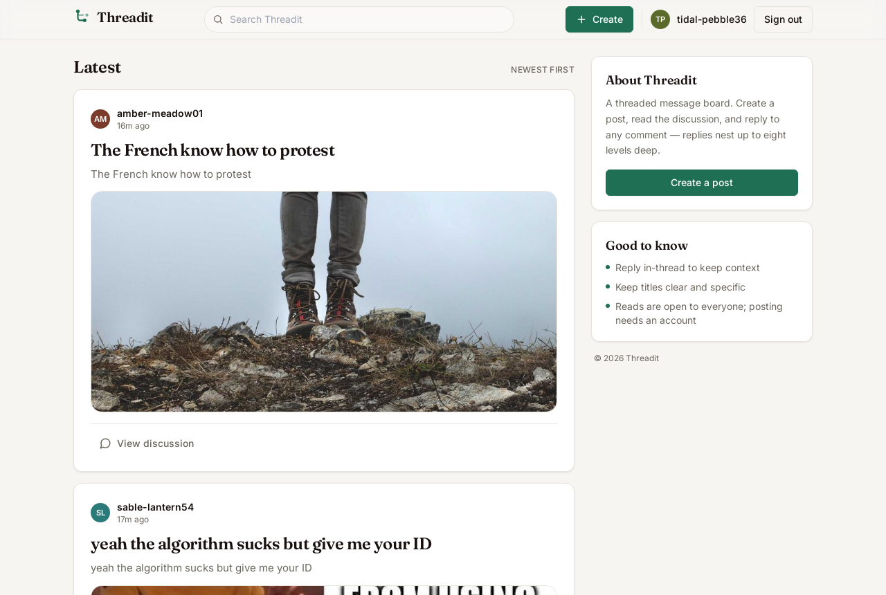
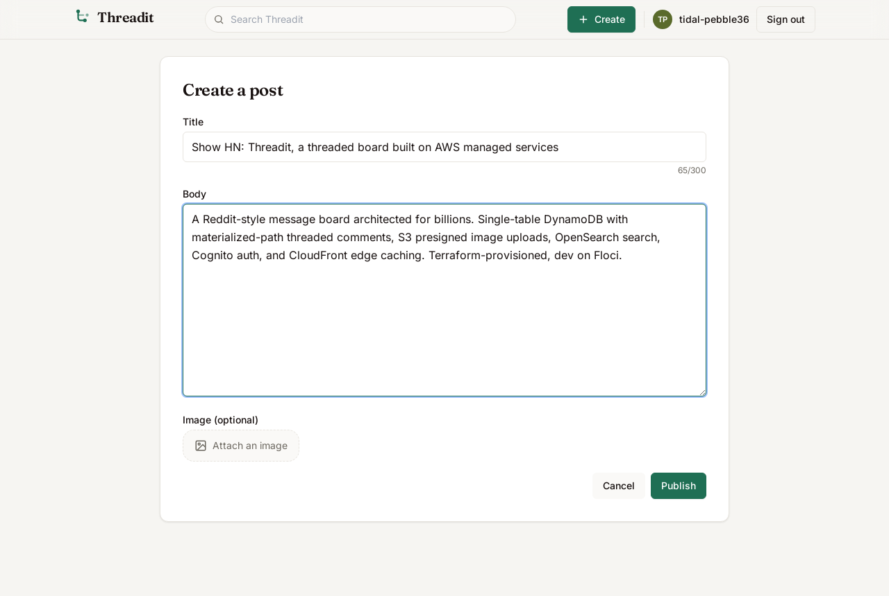
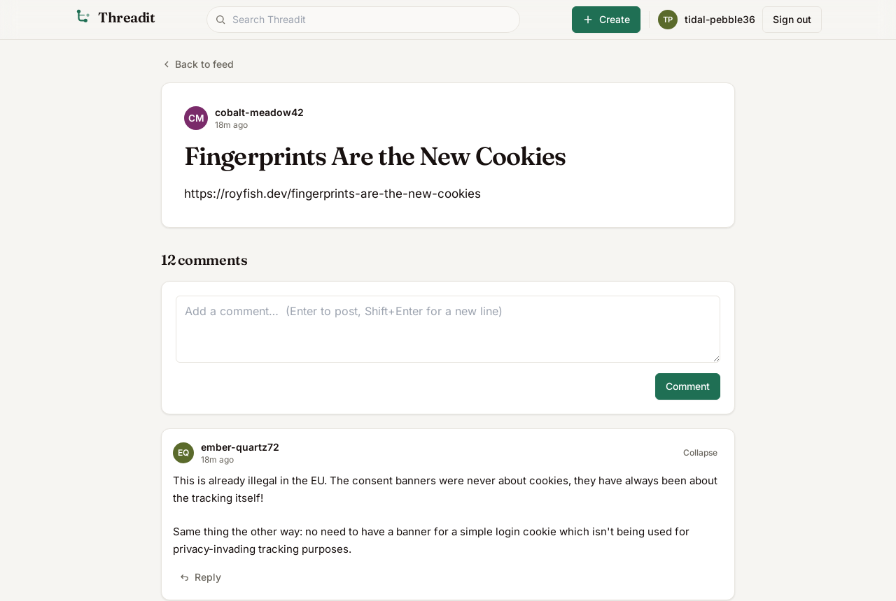
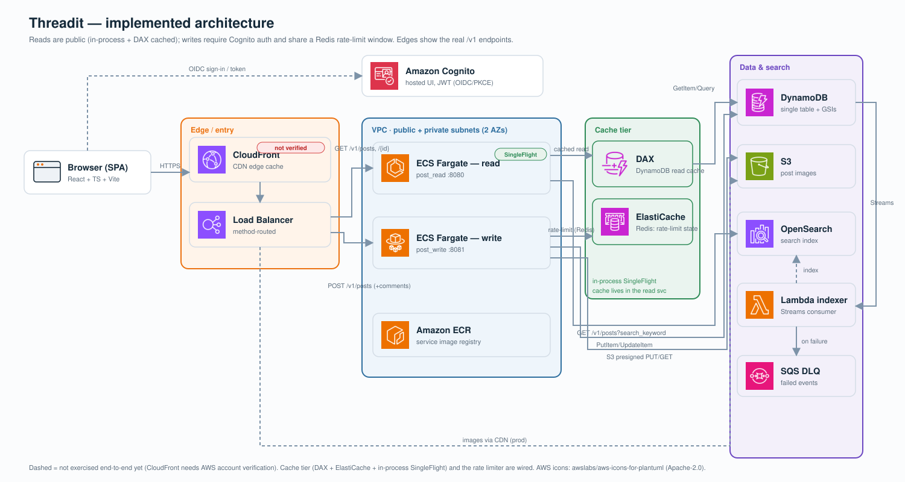

# Threadit

Threadit is a Reddit-style threaded message board, simple to use and architected to
serve billions. It is AWS-managed-service-first, Terraform-provisioned, with a React +
TypeScript frontend and a Python 3.12 / FastAPI backend.

## Screenshots

Running locally on Floci with seeded content (`make app-floci && make seed`).

| Feed | Create a post | Threaded discussion |
|------|---------------|---------------------|
|  |  |  |

## Quickstart (no AWS account needed)

Everything runs locally against the [Floci](https://floci.dev) AWS emulator, with real
DynamoDB/S3/OpenSearch semantics, no cloud bill, and no credentials.

```bash
make setup        # one-time: venv, backend deps, frontend deps, browsers
make app-floci    # start the full app  ->  http://localhost:5173
make app-stop     # stop it
```

`make app-floci` brings up, in order: the Floci emulator, the Terraform-provisioned
dev stack, the read service (`:8080`), the write service (`:8081`), and the Vite
frontend (`:5173`). In this mode auth is stubbed (dev user), so you can post, comment,
reply, attach images, and search immediately.

Prerequisites: `python3`, `node`/`npm`, and `docker`. `make setup` checks for them.

## Run against real AWS

This path deploys the backend to your own AWS account and runs the frontend locally
against the real ALB and a real Cognito user pool (self-service email sign-up).

```bash
make aws-up       # build+push the service image, then terraform apply the backend
make app-aws      # local frontend  ->  AWS backend  ->  http://localhost:5173
make aws-down     # tear the stack down (stops billing)
```

`make app-aws` auto-generates `frontend/.env.local` from the Terraform `prodweb`
outputs, so you do not copy endpoint IDs by hand. The frontend runs on port 5173
because that is the Cognito callback URL registered by Terraform.

### Prerequisites for the AWS path

1. Tools: `terraform`, the `aws` CLI, and `docker`, in addition to the Quickstart tools.
2. AWS credentials configured (`aws configure` or environment variables) for the target
   account. Set the region with `REGION=...` if it is not `eu-central-1`.
3. A deploy IAM identity (for example an IAM user `threadit-deployer`) with permissions
   to create the stack. Required action groups, confirmed against a real apply/destroy:
   - `dynamodb:*`, `cognito-idp:*`, `s3:*`, `ec2:*`, `ecs:*`, `ecr:*`, `logs:*`,
     `elasticloadbalancing:*`, `application-autoscaling:*`, `es:*` (OpenSearch),
     `lambda:*`, `sqs:*`.
   - IAM role management: `CreateRole`, `DeleteRole`, `GetRole`, `PassRole`, `TagRole`,
     `UntagRole`, `ListRoles`, `PutRolePolicy`, `DeleteRolePolicy`, `GetRolePolicy`,
     `AttachRolePolicy`, `DetachRolePolicy`, `ListRolePolicies`,
     `ListAttachedRolePolicies`.
   - `iam:CreateServiceLinkedRole` (ECS and Elastic Load Balancing each need a
     service-linked role; the first apply fails without it). If your account has never
     used ECS, create it once up front:
     `aws iam create-service-linked-role --aws-service-name ecs.amazonaws.com`.
   - For a clean `terraform destroy`: `iam:ListInstanceProfilesForRole` (the provider
     calls it during role deletion). `iam:SimulatePrincipalPolicy` is optional.

   For a quick personal test you can attach `AdministratorAccess` instead of the
   fine-grained list above, but the fine-grained set is the least-privilege baseline.

### Costs and caveats

- The AWS stack is billable while up (roughly $0.10 to $0.15 per hour: ALB, two Fargate
  tasks, and an OpenSearch domain). Run `make aws-down` when you are finished.
- OpenSearch takes 10 to 20 minutes to become available on a first apply; `make aws-up`
  may run long on the initial deploy.
- CloudFront edge caching (the headline feature) requires an AWS-account verification
  that some new accounts do not have by default. If CloudFront creation is blocked, the
  current `make aws-up` path runs without it: the backend and real Cognito auth work,
  images are served via presigned S3 GET, but the CDN layer is not provisioned.

## Common tasks

| Command          | What it does                                             |
|------------------|----------------------------------------------------------|
| `make setup`     | One-command contributor setup                            |
| `make app-floci` | Run the full app locally on Floci (http://localhost:5173)|
| `make app-aws`   | Run local frontend against the deployed AWS backend      |
| `make app-stop`  | Stop locally-launched app processes                      |
| `make aws-up` / `make aws-down` | Deploy / tear down the AWS backend        |
| `make check`     | Lint + run the test suite (CI gate)                      |
| `make floci-down`| Stop the Floci emulator container                        |
| `make help`      | List all targets                                         |

See `frontend/README.md` for frontend-specific config (brand tokens, env, backend
switching) and `artifacts/docs/` for the architecture and design records.

## System design



The diagram shows what is actually provisioned by the Terraform in this repo (the same
code runs against the Floci emulator in dev and real AWS in prod).

Implemented components:

- **CloudFront** — edge cache in front of the API and images (the headline feature;
  requires AWS account verification, see the AWS caveats above).
- **Application Load Balancer** — single entry point that path-routes `POST` requests
  to the write service and everything else to the read service.
- **ECS Fargate (read + write)** — one container image, run as two services:
  `post_read` (`:8080`, public GET) and `post_write` (`:8081`, authenticated POST).
  Pulled from **Amazon ECR**, running inside a **VPC** across two AZs.
- **Amazon Cognito** — hosted-UI sign-in; the SPA uses OIDC/PKCE and the write service
  verifies the JWT access token in-process.
- **DynamoDB** — single-table design with GSIs for the feed and by-user queries, plus
  DynamoDB **Streams** for the search pipeline.
- **S3** — post images, uploaded by the browser via presigned `PUT` and read via
  presigned `GET` (or CloudFront in prod).
- **OpenSearch + Lambda indexer** — a Streams-triggered Lambda projects posts into an
  OpenSearch index for keyword search; failed events go to an **SQS** dead-letter queue.

Request flows:

- **Read** (public): browser → CloudFront → ALB → read service → DynamoDB (and
  OpenSearch for search, presigned S3 GET for images).
- **Write** (authenticated): browser signs in with Cognito → `POST` → ALB → write
  service (verifies JWT) → DynamoDB; images are uploaded directly to S3 via a
  presigned URL.
- **Search indexing** (async): DynamoDB Streams → Lambda indexer → OpenSearch, with an
  SQS DLQ for failures.

The diagram is generated from `docs/architecture/generate_diagram.py` using the official
AWS service icons.

> **Note on CloudFront.** The CloudFront edge-cache path (dashed in the diagram) is
> **not yet verified end-to-end**: creating a CloudFront distribution on this AWS account
> is blocked pending AWS account verification. Everything else — ALB, ECS read/write,
> Cognito auth, DynamoDB, S3 images, OpenSearch search, and the Streams→Lambda indexer —
> was deployed and verified against real AWS.

## License

See [LICENSE](LICENSE).
