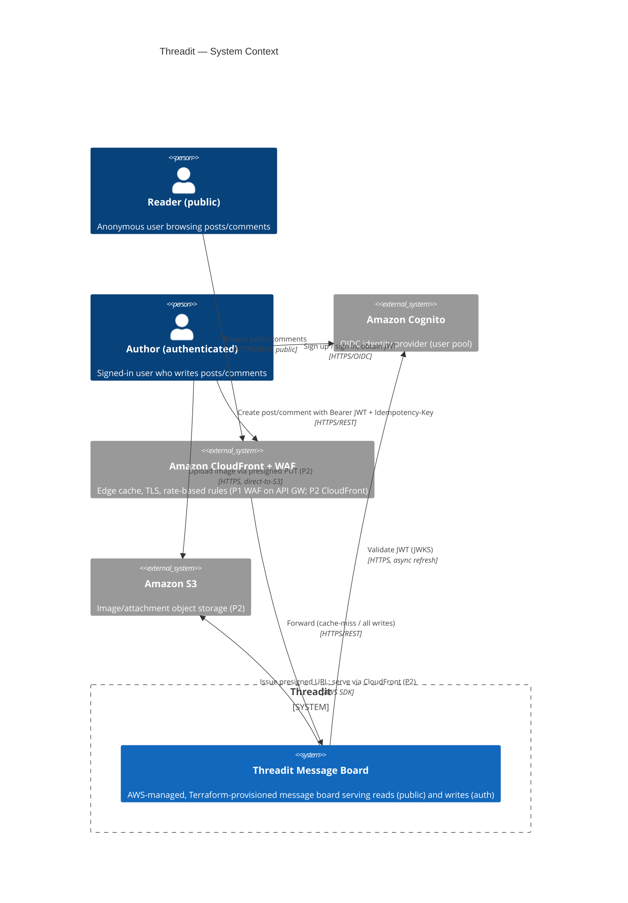
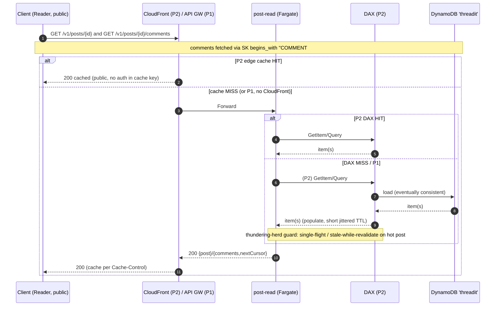

# Threadit — SYSTEM ARCHITECTURE

> Document 3 of 3 (ANALYSIS → PLANNING → **SYSTEM_ARCHITECTURE**).
> Status: Draft for review. Author: Senior System Architect.
> Basis: Formalizes `ANALYSIS.md` (decisions D1–D11, critique) and `PLANNING.md` (phases P1–P3, authoritative data model §1.6). Entity names (**Post, Comment, User**), the single table **`threadit`**, **GSI1/GSI2**, the **/v1** endpoints, **Idempotency-Key** on writes, **Cognito + API Gateway** auth, and **Streams-enabled-in-P1** are identical to the prior two documents by design.
> Golden rule carried through: *"billions" is a capacity ceiling, not a day-1 bill.* The architecture below is correct and future-proof at P1; cost and moving parts are added only as later phases justify them.
> Convention: anything genuinely requiring product/stakeholder input is tagged **[DECISION POINT]**. Nothing here invents certainty beyond the prior docs.

---

## 1. Scope & Quality Attributes (recap, authoritative numbers)

In-scope v1 (P1): create post, create comment (**threaded, materialized path, depth cap 8**), list posts, get post, get comments (tree-ordered), auth on writes, public reads, durable persistence.
Deferred: images (P2), caching/search (P2), subscriptions/feed/fan-out (P3, conditional on **D9**), full observability/DR (P3).

CAP posture: **AP** — availability + partition tolerance prioritized; **eventual consistency accepted** except a narrow read-your-own-write path (D7).

---

## 2. C4 — Context View



Protocols/sync on every external edge are labeled. CloudFront is a P2 addition; in P1 the public entry is **API Gateway + WAF** directly (CloudFront slots in front without an API-shape change).

---

## 3. C4 — Container View

```mermaid
C4Container
  title Threadit — Containers (P1 solid; P2/P3 dashed-in-notes)
  Person(reader, "Reader (public)")
  Person(author, "Author (auth)")

  System_Boundary(tb, "Threadit (single AWS region, multi-AZ)") {
    Container(edge, "CloudFront + WAF", "AWS managed", "P1: WAF rate-based rules on API GW. P2: CloudFront edge cache + WAF for reads/images")
    Container(apigw, "API Gateway (HTTP API)", "AWS managed", "Routing, request validation vs OpenAPI, JWT authorizer on write routes, usage plans/throttling")
    Container(writeSvc, "post-write service", "Fargate (ECS), stateless", "Validates, enforces authz, idempotent writes to DynamoDB")
    Container(readSvc, "post-read service", "Fargate (ECS), stateless", "Serves GET posts/comments; P2 routes search to OpenSearch, uses DAX/ElastiCache")
    ContainerDb(ddb, "DynamoDB table 'threadit'", "AWS managed, on-demand/provisioned+autoscaling", "Single table: Post/Comment/User/Idempo items; GSI1 latest, GSI2 by-user; PITR; Streams ON")
    Container(streams, "DynamoDB Streams", "AWS managed", "NEW_AND_OLD_IMAGES change feed — no consumer in P1; consumers attach in P2/P3")
  }
  System_Ext(cognito, "Cognito user pool", "OIDC")

  Rel(reader, edge, "GET (public)", "HTTPS")
  Rel(author, edge, "POST (JWT + Idempotency-Key)", "HTTPS")
  Rel(edge, apigw, "Forward", "HTTPS")
  Rel(apigw, cognito, "Validate JWT via JWKS", "HTTPS")
  Rel(apigw, writeSvc, "POST routes (authorized)", "HTTPS/REST, sync")
  Rel(apigw, readSvc, "GET routes (public)", "HTTPS/REST, sync")
  Rel(writeSvc, ddb, "PutItem/UpdateItem (conditional, idempotent)", "AWS SDK, sync")
  Rel(readSvc, ddb, "Query/GetItem (eventually consistent; narrow ConsistentRead)", "AWS SDK, sync")
  Rel(ddb, streams, "Change records", "async")
```

**P2 additions (dashed, see PLANNING §2):** OpenSearch domain + Lambda stream-indexer (async via Streams); DAX in front of DynamoDB for the read service; ElastiCache (Redis) for approximate counters + rate-limit state; S3 bucket + CloudFront OAC for images.
**P3 additions (conditional on D9, PLANNING §3):** feed projection store + fan-out workers on Streams (async); observability stack.

**Note on "deploy same codebase twice":** per ANALYSIS/D1 this is **read/write service separation**, NOT CQRS. Both services talk to the **same** DynamoDB write model in P1. The **first true CQRS read model** is OpenSearch in P2 (fed asynchronously by Streams); the second is the feed projection in P3. The container view reflects that honestly.

---

## 4. Data Model — DynamoDB single table `threadit`

Single table, access-pattern-driven (ADR-001). All items carry `entityType`, `createdAt`, `updatedAt` (ISO-8601 UTC), `schemaVersion`. Identical to PLANNING §1.6.

### 4.1 Primary keys & GSIs

| Item | PK | SK | GSI1PK / GSI1SK (latest posts) | GSI2PK / GSI2SK (by user) | Key attrs |
|------|----|----|-------------------------------|---------------------------|-----------|
| **Post** | `POST#<postId>` | `META#<postId>` | `BUCKET#<yyyymmddhh>` / `TS#<createdAt>#<postId>` | `USER#<userId>` / `TS#<createdAt>#<postId>` | `title`, `body`, `userId`, `createdAt`, `updatedAt`, `schemaVersion`, `commentCountApprox` (optional) |
| **Comment** | `POST#<postId>` | `COMMENT#<path>` where path = `<rootTs>#<ancestors…>#<ownTs>#<commentId>` | — | `USER#<userId>` / `TS#<createdAt>#<commentId>` | `text`, `userId`, `parentId` (null=top-level), `depth` (int, cap 8), `rootCommentId`, `attachment` (nullable, **reserved** P2), `createdAt`, `schemaVersion` |
| **User** | `USER#<userId>` | `PROFILE#<userId>` | — | — | `displayName`, `createdAt`, `schemaVersion` |
| **Idempo** | `IDEMPO#<key>` | `IDEMPO#<key>` | — | — | `targetId`, `ttl` (DynamoDB TTL attribute) |

GSI projection: **[DECISION POINT]** GSI1/GSI2 recommended as `INCLUDE` (title, userId, createdAt, commentCountApprox) to keep list payloads cheap without full `ALL` projection cost; confirm the exact attribute set with product once the list UI is final.

### 4.2 Access patterns → key mapping

| ID | Access pattern | Operation | Keys | Phase |
|----|----------------|-----------|------|-------|
| **AP1** | Get a single post | `GetItem` | PK=`POST#<id>`, SK=`META#<id>` | P1 |
| **AP2** | Get comment tree for a post (thread-ordered, paged) | `Query` | PK=`POST#<id>`, SK `begins_with COMMENT#` | P1 |
| **AP2b** | Lazy-load one thread's subtree ("load more replies") | `Query` | PK=`POST#<id>`, SK `begins_with COMMENT#<rootPath>` | P1 |
| **AP3** | List latest posts (approx global order) | `Query` on **GSI1** | GSI1PK=`BUCKET#<yyyymmddhh>` (scan recent buckets desc), GSI1SK desc | P1 |
| **AP4** | List a user's posts | `Query` on **GSI2** | GSI2PK=`USER#<id>`, GSI2SK desc | P1 |
| **AP5** | Search posts by keyword | OpenSearch query (NOT DynamoDB) | — | **P2** |
| **AP6** | Personalized feed | Feed projection store | — | **P3, conditional D9** |
| **AP7** | Idempotency check on write | conditional `PutItem` | PK/SK=`IDEMPO#<key>` | P1 |

**Latest-posts via time buckets (AP3):** `GSI1PK = BUCKET#<yyyymmddhh>` spreads the "newest N posts" hot read across hourly partitions instead of one monotonic partition (which would hot-spot at billions scale — ANALYSIS §3.2). The read service queries the current bucket, then the previous bucket(s) descending until `limit` is filled. **[DECISION POINT]** bucket granularity (hour vs minute) depends on peak write RPS; start hourly, tune from P2 load tests.

**Hot-partition mitigations (carried from PLANNING §1.6):**
- Viral-post **read** storms → handled at the cache tier (DAX/CloudFront) in P2, not by key redesign.
- Single-post **comment-write** storms exceeding a partition's WCU → optional **write-sharding**: comment PK becomes `POST#<id>#<shard>` with scatter-gather read. **Designed-for, off by default**; activation threshold is a **[DECISION POINT]** tuned from P2 load tests.

---

## 5. API Contracts (OpenAPI-style, `/v1`)

Full OpenAPI 3.1 is authored in P1-DEV-02. Below is the authoritative shape all three docs honor. URI versioning (`/v1`). Writes require `Authorization: Bearer <JWT>` and `Idempotency-Key`. Reads are public (FR6).

### 5.1 Shared components

**Error envelope (RFC 9457 problem+json):**
```json
{ "type": "https://threadit/errors/validation",
  "title": "Invalid request",
  "status": 400,
  "detail": "title must be 1..300 chars",
  "correlationId": "c-7f3a...",
  "retryable": false }
```

**Cursor pagination:** request `?limit=<n>&cursor=<opaque>`; response:
```json
{ "items": [ ... ], "nextCursor": "base64(LastEvaluatedKey)|null", "limit": 20 }
```
`cursor` is an opaque base64 of DynamoDB `LastEvaluatedKey` (or OpenSearch `search_after` for AP5). Offset pagination is explicitly rejected at scale (ANALYSIS); `last=5|10|20` from the sketch maps to `limit`.

**Idempotency:** `Idempotency-Key` header (client-generated UUID) required on all POSTs. Server writes an `IDEMPO#<key>` sentinel via conditional `PutItem`; a replay returns the original result, never a duplicate item.

### 5.2 Endpoints

| Method & path | Auth | Request | Success | Notes |
|---------------|------|---------|---------|-------|
| `POST /v1/posts` | **Required** | `{ "title": str(1..300), "body": str }` + `Idempotency-Key` | `201 { post }` canonical repr | userId derived from JWT `sub`; client-supplied id/userId/timestamps ignored (mass-assignment guard) |
| `POST /v1/posts/{post_id}/comments` | **Required** | `{ "text": str, "parentId"?: str }` + `Idempotency-Key` | `201 { comment }` | separate Comment item; `parentId` null = top-level reply; server computes materialized `path`/`depth`/`rootCommentId`; **rejects beyond depth 8 (422)** (D3) |
| `GET /v1/posts` | Public | `?limit&cursor&last=5\|10\|20&user_id&search_keyword` | `200 { items, nextCursor }` | `user_id`→GSI2; default/`last`→GSI1; **`search_keyword` returns a defined 501/"not-yet-available" in P1**, routes to OpenSearch in P2 |
| `GET /v1/posts/{post_id}` | Public | — | `200 { post }` / `404` | AP1; optional `?consistent=true` narrow ConsistentRead for author read-your-own-write (D7) |
| `GET /v1/posts/{post_id}/comments` | Public | `?limit&cursor&rootCommentId` | `200 { items, nextCursor }` | AP2 tree-ordered (incl. `depth`, `parentId`); `rootCommentId` → AP2b lazy subtree load |
| `POST /v1/posts/{post_id}/attachments:presign` | **Required** | `{ "contentType", "sizeBytes" }` | `200 { url, objectKey, expiresIn }` | **P2**; short-lived S3 presigned PUT; server validates type/size; per-user key prefix |
| `POST /v1/users/{user_id}/subscription` / `DELETE ...` | **Required** | — | `201`/`204` | **P3, conditional D9** |
| `GET /v1/feed` | **Required** | `?limit&cursor` | `200 { items, nextCursor }` | **P3, conditional D9**; hybrid push/pull; lag documented |

**API metadata:** each endpoint in the OpenAPI spec carries ownership, version, rate-limit tier, examples, and deprecation policy (additive-only changes within `/v1`; breaking changes → `/v2`).

**Error status catalog:** 400 validation, 401 missing/invalid JWT (writes), 403 authz/IDOR, 404 not found, 409 idempotency conflict, 422 reply exceeds max depth (8), 429 throttled (WAF/usage plan, with `Retry-After`), 501 search-not-yet-available (P1), 503 dependency degraded (e.g., OpenSearch down in P2 — search only).

---

## 6. Sequence Diagrams

### 6.1 Create post (write path, auth, idempotency, stream)
```mermaid
sequenceDiagram
  autonumber
  participant C as Client (Author)
  participant GW as API Gateway (+WAF)
  participant Cog as Cognito (JWKS)
  participant W as post-write (Fargate)
  participant D as DynamoDB 'threadit'
  participant S as Streams (no consumer in P1)

  C->>GW: POST /v1/posts {title,body} + Bearer JWT + Idempotency-Key
  GW->>GW: WAF rate check; validate body vs OpenAPI
  GW->>Cog: Validate JWT signature/claims (cached JWKS)
  Cog-->>GW: valid (sub=userId)
  GW->>W: Forward (userId from token)
  W->>D: PutItem IDEMPO#<key> (ConditionExpression attribute_not_exists)
  alt key already seen
    D-->>W: ConditionalCheckFailed
    W->>D: GetItem original post by targetId
    W-->>C: 201 (original canonical post)
  else first time
    D-->>W: ok
    W->>D: PutItem Post (PK=POST#id, SK=META#id, GSI1/GSI2 attrs)
    D-->>W: ok
    D-)S: change record (async, buffered for P2/P3)
    W-->>C: 201 {post} (enables optimistic UI / read-your-own-write)
  end
```

### 6.2 Create comment
```mermaid
sequenceDiagram
  autonumber
  participant C as Client (Author)
  participant GW as API Gateway (+WAF)
  participant W as post-write (Fargate)
  participant D as DynamoDB 'threadit'
  participant S as Streams

  C->>GW: POST /v1/posts/{id}/comments {text, parentId?} + JWT + Idempotency-Key
  GW->>GW: WAF + validate + JWT (as 6.1)
  GW->>W: Forward (userId from token)
  W->>D: Conditional PutItem IDEMPO#<key>
  alt parentId present
    W->>D: GetItem parent comment (read its path/depth)
    D-->>W: parent {path, depth}
    W->>W: depth+1; reject 422 if > 8; compute SK=COMMENT#<parentPath>#<ownTs>#<cid>, rootCommentId
  else top-level reply
    W->>W: depth=0; SK=COMMENT#<ownTs>#<cid>; rootCommentId=cid
  end
  W->>D: PutItem Comment (PK=POST#id, SK=COMMENT#<path>, parentId, depth, rootCommentId)
  D-->>W: ok
  Note over W,D: commentCountApprox updated out-of-band (counter item / P2 ElastiCache) — NO read-modify-write on Post
  D-)S: change record (async)
  W-->>C: 201 {comment}
```

### 6.3 Read post + replies (cache hit/miss)


### 6.4 Image upload via S3 presigned URL (P2)
```mermaid
sequenceDiagram
  autonumber
  participant C as Client (Author)
  participant GW as API Gateway
  participant W as post-write (Fargate)
  participant S3 as S3 (private bucket)
  participant CF as CloudFront (OAC)

  C->>GW: POST /v1/posts/{id}/attachments:presign {contentType,sizeBytes} + JWT
  GW->>W: Forward (authorized)
  W->>W: Validate type/size; derive per-user objectKey
  W->>S3: Generate presigned PUT URL (short TTL, SDK)
  W-->>C: 200 {url, objectKey, expiresIn}
  C->>S3: PUT image bytes directly (presigned URL) — server never proxies bytes
  S3-->>C: 200
  C->>GW: (optional) PATCH/PUT attachment ref onto Post/Comment 'attachment' field + JWT
  GW->>W: Forward; W writes attachment=objectKey
  Note over C,CF: Later reads: image served via CloudFront OAC from private bucket
```

### 6.5 Search (P2)
```mermaid
sequenceDiagram
  autonumber
  participant C as Client (Reader, public)
  participant GW as API Gateway
  participant R as post-read (Fargate)
  participant OS as OpenSearch
  participant L as Lambda indexer
  participant S as Streams
  participant D as DynamoDB

  Note over D,OS: ASYNC indexing path (eventual): post write -> Streams -> Lambda -> OpenSearch (lag seconds)
  D-)S: Post insert/modify/remove
  S-)L: batch (NEW_AND_OLD_IMAGES)
  L->>OS: upsert/delete doc {postId,title,body,userId,createdAt} (idempotent; DLQ on poison)

  Note over C,OS: READ path
  C->>GW: GET /v1/posts?search_keyword=foo&limit&cursor
  GW->>R: Forward (public)
  alt OpenSearch healthy
    R->>OS: query (search_after cursor)
    OS-->>R: hits
    R-->>C: 200 {items,nextCursor} (+ indexing-lag note in metadata)
  else OpenSearch down
    R-->>C: 503 search degraded (non-search reads unaffected)
  end
```

---

## 7. SLOs / SLIs

Formalizes PLANNING §3.7. **Exact targets are a [DECISION POINT] to confirm with product**; the values below are the recommended starting commitments.

| Dimension | SLI (how measured) | SLO (recommended start) | Notes |
|-----------|--------------------|-------------------------|-------|
| Read latency (cache hit) | p99 edge/DAX hit | **≤ 50 ms** | P2 cache tier |
| Read latency (edge/overall) | p99 at CloudFront | **≤ 150 ms** | includes miss path |
| Write latency | p99 POST /v1/posts, /comments | **≤ 300 ms** | idempotent conditional write |
| Availability | successful (non-5xx) / total, per endpoint class | **≥ 99.95%** | single-region multi-AZ (D10) |
| Durability | DynamoDB managed | **AWS DynamoDB durability** + PITR | not independently claimed beyond AWS |
| Search freshness | p95 Streams→OpenSearch lag | **< 10 s** | P2; surfaced in response metadata |
| Read-your-own-write | author re-fetch correctness | **100% via narrow ConsistentRead** | D7; everything else eventual |
| Throttle correctness | 429 w/ Retry-After under abuse | enforced at WAF + usage plans | DoS protection on read class |

Error budget drives P3 alerting (burn-rate alerts, PLANNING P3-INFRA-A2). **[DECISION POINT]** whether availability must rise to 99.99% — that forces the deferred multi-region decision (D10) and materially changes cost.

---

## 8. Architecture Decision Records (ADRs)

### ADR-001 — DynamoDB single-table design + AP consistency
- **Context:** Billions-scale, write-heavy comments, read-heavy posts; NFR prioritizes HA/scale/throughput/partition-tolerance; CAP → AP, eventual consistency acceptable.
- **Options:**
  1. **DynamoDB single-table** — pros: horizontal auto-partitioning, predictable single-digit-ms access by key, managed, Streams for CQRS; cons: access-pattern lock-in, no ad-hoc queries, modeling discipline required; cost: pay-per-capacity, cheap at key access; risk: hot partitions if keys naive.
  2. DynamoDB multi-table — pros: simpler per-entity mental model; cons: cross-entity transactions/joins harder, more items to keep consistent; cost: similar; risk: duplicated hot-key issues.
  3. Relational (Aurora) — pros: joins, strong consistency, search-ish; cons: horizontal write scaling and partition tolerance weaker at this ceiling; cost: higher ops/scale; risk: write bottleneck at billions.
- **Decision:** **Single-table DynamoDB, AP, eventual consistency**, with access-pattern-driven keys (§4), GSI1 time-bucketed for latest, GSI2 by-user. Narrow ConsistentRead only for read-your-own-write.
- **Consequences:** Must design all access patterns up front; search and feed cannot be served by DynamoDB and move to purpose-built stores (ADR-004/009). Hot partitions mitigated by time-buckets + caching + optional write-sharding, not key redesign.

### ADR-002 — CQRS realization (service separation now, Streams→read-models later)
- **Context:** User proposed "deploy same app twice (read/write)" as CQRS. True CQRS separates read/write **models**, not app instances.
- **Options:** (1) Call the twice-deployed app "CQRS" — misleading, no model separation. (2) **Label it service separation**; realize true CQRS via Streams→projections when a read genuinely needs a different model (search, feed). (3) Full CQRS from day 1 — premature complexity/cost.
- **Decision:** **P1 = read/write service separation over one DynamoDB write model** (load isolation, independent scaling/IAM). **P2 = first true CQRS read model (OpenSearch via Streams→Lambda). P3 = feed projection (conditional).**
- **Consequences:** Honest naming; both P1 services share the write model (reads eventually consistent). Streams enabled in P1 so projections attach with no table change.

### ADR-003 — Threaded replies via materialized path (v1)
- **Context:** The product is **"Threadit"** — threading is on-brand and expected (D3). The hazard is deep-thread read cost in a key-value store; the fix is the right encoding, not avoiding threads.
- **Options:** (1) Flat — pros: single SK range query, cheap; cons: **no nested tree — off-brand for Threadit**. (2) Adjacency list (`parentId` only) — pros: arbitrary depth; cons: N+1 / recursive reads, deep-thread read cost at scale. (3) **Materialized path** — pros: whole tree or any subtree in **one `Query`** (SK range), stays within DynamoDB strength; cons: immutable paths (no cheap re-parent), slightly larger items, requires a depth cap.
- **Decision:** **Threaded via materialized path in v1.** Comment SK = `COMMENT#<rootTs>#<ancestors…>#<ownTs>#<commentId>`; `parentId`, `depth`, `rootCommentId` are **active**. `SK begins_with "COMMENT#"` → full tree in thread order (one round trip); `SK begins_with "COMMENT#<rootPath>"` → one subtree for lazy "load more replies." **Max depth = 8** ("continue thread" beyond). Default read shape: full tree up to a per-post comment limit, then lazy-load deep subtrees.
- **Consequences:** Threading is first-class and cheap to read; paths are immutable (acceptable for a board); write path computes the path + enforces the depth cap; still fully AP / eventually consistent. **[DECISION POINT]** depth cap (8) and read shape are confirmable defaults.

### ADR-004 — Search via OpenSearch
- **Context:** `GET /v1/posts?search_keyword=` cannot be served efficiently by DynamoDB (no full-text).
- **Options:** (1) DynamoDB scan/filter — rejected: full-table scan, unbounded cost. (2) **OpenSearch** fed by Streams — pros: real relevance/full-text, `search_after` paging; cons: always-on cluster cost, eventual indexing lag, extra failure domain. (3) Third-party search SaaS — lock-in, data-egress.
- **Decision:** **OpenSearch read model (P2)**, async-indexed via Streams→Lambda (idempotent, DLQ). API shape unchanged from P1 (search declared in P1, wired in P2).
- **Consequences:** Search is eventually consistent (lag SLO < 10 s). OpenSearch down → search 503s while all other reads continue (graceful degradation). Cost line-item flagged.

### ADR-005 — Caching strategy (three tiers, TTL expiry)
- **Context:** Low-latency reads + hot/viral posts; eventual consistency makes precise invalidation hard.
- **Options:** (1) No cache — fails latency at scale. (2) Single tier — insufficient coverage. (3) **Three tiers: CloudFront (edge/public GET + images), DAX (hot DynamoDB items/queries), ElastiCache/Redis (approximate counters + rate-limit state)**.
- **Decision:** **Three-tier cache in P2**, **short jittered TTL expiry over precise invalidation** (aligned with AP consistency). Thundering-herd guards: single-flight/request-coalescing + stale-while-revalidate on hot keys. Author's consistent re-fetch (D7) is **not** cached.
- **Consequences:** Readers may see slightly stale data (acceptable per AP/D7). Cache hit-ratio is a first-class SLI. DAX down → fall back to DynamoDB; CloudFront/ElastiCache failures degrade latency, not correctness.

### ADR-006 — Auth: Cognito + API Gateway authorizer (NOT CloudFront)
- **Context:** User sketch put "auth" at CloudFront. CloudFront does edge/caching/WAF, not identity.
- **Options:** (1) Auth at CloudFront — rejected: wrong layer. (2) **Cognito user pool (OIDC) + API Gateway JWT authorizer on write routes + service-level resource authz**. (3) Custom auth service — reinventing a solved problem.
- **Decision:** **Cognito issues JWT; API Gateway validates (JWKS) on write routes; reads public; services enforce "write only as yourself" (userId from token) to prevent IDOR/BOLA**; mass-assignment guard.
- **Consequences:** Writes gated at the edge of the app tier; least-privilege task roles (write role: Put/Update; read role: Query/Get). CloudFront/WAF handle volumetric defense, not identity.

### ADR-007 — Image upload via S3 presigned URL (P2)
- **Context:** Images deferred; server must not proxy large binaries.
- **Options:** (1) Proxy bytes through Fargate — rejected: bandwidth/latency/cost. (2) **Presigned S3 PUT** direct from client; store object key in reserved `attachment` field; serve via CloudFront OAC from a **private** bucket. (3) Public bucket — rejected: insecure.
- **Decision:** **Presigned PUT (short TTL), server validates type/size + per-user key prefix; private bucket + CloudFront OAC for delivery.**
- **Consequences:** Server scales independent of payload size; `attachment` reserved in P1 schema makes this additive/non-breaking.

### ADR-008 — Rate limiting placement
- **Context:** NFR: protect a single operation class (e.g., reads) from throughput abuse/DoS.
- **Options:** (1) In-app only — too late, wastes compute. (2) **Layered: WAF rate-based rules (volumetric, P1) + API Gateway usage plans/quotas (per-client/tier, P2) + ElastiCache-backed app counters for fine-grained limits**.
- **Decision:** **Defense-in-depth rate limiting**: WAF first (coarse, edge), API GW usage plans (per endpoint class/tier), app-level counters for precision. 429 + `Retry-After`.
- **Consequences:** Read class can be throttled independently of writes. Correct 429 semantics tracked as an SLI.

### ADR-009 — Fan-out / feed strategy (DEFERRED, conditional on D9)
- **Context:** Celebrity problem (50M subscribers) only exists **if** Threadit has a per-user feed. A message board may only need a **shared board list**.
- **Options:** (1) Build feed + hybrid fan-out in v1 — premature; large cost/complexity for an unconfirmed feature. (2) **Defer; if confirmed, hybrid push (fan-out-on-write) for normal users + pull (fan-out-on-read) for celebrities, merged at read, on a separate CQRS feed projection**. (3) Pure push or pure pull — fails at either the celebrity-write or celebrity-read extreme.
- **Decision:** **Defer entirely to P3, gated on D9.** If D9 = "shared board list," feed/fan-out is **not built** (served by AP3 latest-posts). If D9 = "personalized feed," build the hybrid on a Streams-fed projection.
- **Consequences:** No fan-out code in the P1/P2 hot path; `user-subscriber` from the sketch does not enter v1. **[DECISION POINT D9] blocks P3 Track B scope.**

### ADR-010 — Compute: Fargate (request) + Lambda (async stream processors)
- **Context:** Need stateless horizontally-scalable request services and event-driven async consumers.
- **Options:** (1) EC2/K8s — more ops than warranted. (2) **Fargate for request services (long-lived, autoscaled on CPU/RequestCount) + Lambda for Streams consumers (indexer, fan-out)**. (3) All-Lambda for request path — cold-start/latency risk for sustained high throughput.
- **Decision:** **Fargate request tier + Lambda for Streams-driven async work** (D11).
- **Consequences:** Managed, autoscaling, least-ops; async failure isolated with DLQs; graceful shutdown/drain on deploys.

---

## 9. Risk Register

| ID | Risk | Category | Likelihood | Impact | Mitigation | Owner |
|----|------|----------|------------|--------|------------|-------|
| R1 | Hot partition on viral post (read storm) | Performance/Scale | Med | High | GSI1 time-buckets; DAX+CloudFront caching (P2); single-flight/stale-while-revalidate | DB + API arch |
| R2 | Hot partition on single-post comment writes | Performance/Scale | Low-Med | High | Optional write-sharding `POST#<id>#<shard>` + scatter-gather; threshold tuned from load tests | DB arch |
| R3 | Eventual-consistency UX ("my post vanished") | UX/Correctness | High | Med | Return canonical repr on write (optimistic UI); narrow ConsistentRead for author (D7); document lag | UX + API arch |
| R4 | Cost blowup at "billions" (OpenSearch/DAX/ElastiCache always-on, NAT, Streams) | Cost/Ops | Med | High | Phase-gate spend; on-demand in dev, provisioned+autoscaling prod; cost dashboard + line-items; VPC endpoints over NAT | Sys arch |
| R5 | Vendor lock-in (DynamoDB/Streams/Cognito deep coupling) | Strategic | High | Med | Accepted tradeoff for managed-scale; repository pattern + DTOs isolate access; documented exit cost | Sys arch |
| R6 | Search sync lag / indexer failure (poison records) | Reliability | Med | Med | Idempotent indexer; DLQ + iterator-age alarm; 503-degrade search only; lag SLO <10 s | API + DB arch |
| R7 | Fan-out cost/complexity if feed built prematurely | Delivery/Cost | Med | High | Deferred + D9-gated (ADR-009); not in P1/P2 hot path | Sys arch |
| R8 | Single-region = regional outage SPOF | Availability | Low | High | Multi-AZ v1; PITR; DR drill (P3); multi-region deferred [DECISION POINT vs 99.99% SLO] | Sys arch |
| R9 | AuthZ gaps (IDOR/BOLA, mass assignment) | Security | Med | High | userId from token not body; resource-level authz; mass-assignment guard; negative tests in CI | Security reviewer |
| R10 | Idempotency failure → duplicate posts/comments on retry | Correctness | Med | Med | Idempotency-Key + conditional PutItem sentinel w/ TTL; replay test in CI | API arch |
| R11 | WAF/rate-limit misconfig → either DoS-exposed or legit-user throttling | Security/UX | Med | Med | Layered limits (ADR-008); tune thresholds; monitor 429 rate as SLI | Security + API arch |
| R12 | Thundering herd on cache expiry of a hot post | Performance | Med | Med | Jittered TTLs, single-flight, stale-while-revalidate (ADR-005); load-tested in P2 | API arch |
| R13 | PII/secrets in logs | Security/Compliance | Low | High | Structured logs w/ redaction; no secrets in code/tfvars; Secrets Manager/KMS | Security reviewer |

---

## 10. Dev vs Prod Differences (recap, PLANNING §5)
- **Capacity:** dev = DynamoDB on-demand, single small Fargate task, no DAX/OpenSearch until P2; prod = provisioned+autoscaling, multi-AZ, right-sized caches/cluster.
- **Sampling:** dev traces 100%; prod sampled.
- **Must NEVER differ:** auth path (Cognito+authorizer), idempotency, single-table schema, API `/v1` contract, WAF presence, PITR/encryption (SSE-KMS), least-privilege IAM. Enforced identically by Terraform.

---

## 11. Open Decision Points (consolidated)
- **D9** personalized feed vs shared board list — gates ADR-009 / P3 Track B. **Must resolve before P3.**
- **Exact SLO numbers** (§7) — confirm with product; 99.99% availability would force the multi-region (D10) decision and raise cost.
- **GSI1 bucket granularity** and **GSI projection attribute set** (§4) — tune from P2 load tests / final list UI.
- **Write-sharding activation threshold** for hot-post comments (§4, R2) — tune from P2 load tests.
- **Multi-region** (D10, R8) — deferred; revisit against availability SLO at P3-INFRA-A3.
- **Threading in v1** (ADR-003) — **decided: threaded via materialized path, depth cap 8**; confirm the depth cap / default read shape if you want different values.
